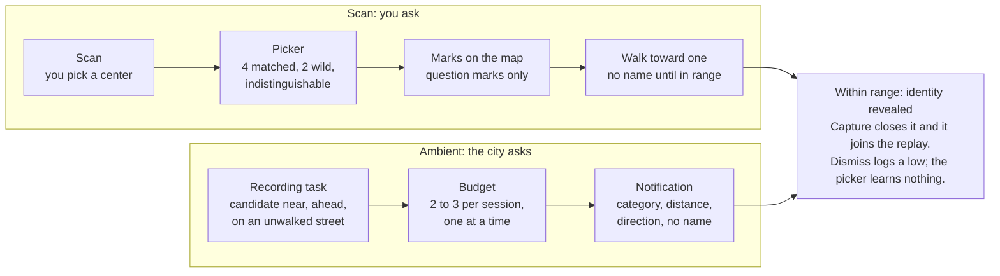
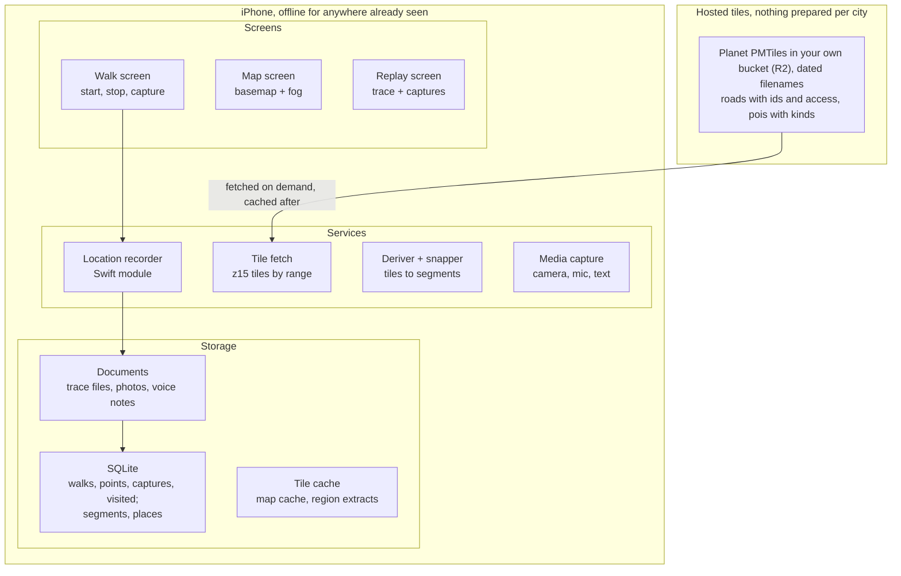

# Chronicles: concept

Last updated 2026-10-29 · Miguel Guerrero

This document is the source of truth for what Chronicles is and why it is built the way it is. Research behind the technical choices is in [research/walking-app-implementation-patterns.md](research/walking-app-implementation-patterns.md).

## What it is

An iOS app for people who explore towns on foot with no plan. It records where you walked at street level, keeps the photos and notes you took along the way, and replays the walk afterward as a souvenir. Guidance, when it arrives, says where there is a lot to see and never whether any of it is good.

Audience: explorers and the spontaneous. Name: Chronicles.

What it is not:

- Not a review site. No ratings, no recommendations, no "best of."
- Not a trip planner. Planning is optional and never required to start a walk.
- Not a photo app. Photos live inside a walk, not in the camera roll.
- Not social, for now. Sharing is a later decision, taken only if the base loop proves enticing.

## Hypotheses the proof of concept tests

The POC exists to answer two questions, not to ship features.

1. Souvenir value: a walk replayed with its photos and notes gets revisited, where the same photos loose in a camera roll would not.
2. Behavior change: seeing which streets you have not walked changes where you go next time.

How to judge: after ten walks in one city, count the replays you opened unprompted and the times you chose a street because the map showed it unwalked. If neither happens, the base loop is not enticing enough, and sharing would not rescue it.

## The core loop

Tap start, walk, capture, tap stop, replay. The fog clears when you stop.

1. Start. One tap opens a session. Location recording begins and keeps running with the phone in your pocket.
2. Walk. The trace accumulates. Nothing on screen asks for attention.
3. Capture. One tap for a photo, a voice note, or a line of text. Each is stamped with time and position, and later with the street segment and what was nearby.
4. Stop. The trace is snapped to street segments. Those segments turn from fog to walked.
5. Replay. The walk animates along the map, and captures appear in order where they were taken.

Optional, before start: a planning step where you pick a few stops and the app threads a path between them. Not in v0.

## Discovery: scan and proximity

Two ways in, one way out. Scan is you asking; ambient proximity is the city answering unasked. Both resolve the same way, and neither lands before v0.5, when the places table exists.

|  | Scan | Ambient |
| --- | --- | --- |
| Trigger | You tap scan, here or on a chosen spot on the map | The recording task notices a candidate near, ahead, and on an unwalked street |
| How many | About six marks per scan | Two or three alerts per session, never on a schedule, some sessions none |
| Mix | Leans toward your preferences, with wildcards | Leans toward wildcards |
| What you know first | A question mark on the map, nothing more | Category, distance and direction, no name |
| Identity | Revealed within range (50 to 75 m, while closing in) | Revealed on arrival |
| Closes when | You capture something there, or dismiss | Same |

Picker rules, shared by both:

- Preferences change the proportion of marks, never whether a category can appear. Settings are explicit: more, normal or less per category, with no "never."
- Marks are indistinguishable. You cannot tell a matched mark from a wildcard.
- The picker does not learn from behavior. A dismiss logs a low in the chronicle and changes nothing.
- Never the same thing twice, across all sessions.

Mechanics:

- A scan takes a center and a radius, so "scan there" from home is the pre-planning step; marks persist into the session.
- Re-scan replaces unresolved marks and keeps resolved ones.
- Proximity runs only inside a session, from the location task already recording the walk; alerts are local notifications, no server.
- One notification at a time: ambient stays quiet while a scanned mark is being pursued.
- Range is generous and direction-aware, because city GPS wobbles by tens of meters. Proximity is a distance check inside the recording task, not a geofence; direction uses the travel course only when iOS reports it as accurate, else the bearing from a fix 20–30 m back.
- Opt-in, with a "quiet walk" toggle per session. An optional auto-scan at session start gives non-scanners the ambient experience.

Both lanes end in the same place: a name is only ever learned within range, and a capture is what closes a mark and carries it into the replay.

## Memory: revisit, recall, retrace

Memory is the chronicle read by place instead of by time. Recall is explicit: you flag a capture yourself, and nothing is ever calculated for you.

| Piece | What it does | Lands |
| --- | --- | --- |
| What happened here | Tap a spot or a walked street and see every capture within range, across all walks, with its walk context ("Oct 20, 40 minutes in, just after the bakery") | v0.5; a query over data v0 already stores |
| Retrace | The current trace drawn backward, with a "walk me back" option; across sessions, the fog table shows each time you entered this street and from which direction | v0.5; no routing engine |
| Remind me here | A flag on a capture; when a later session passes within range, a notification shows your note, photo or voice memo | As soon as proximity exists |

Remind me here, the rules:

- Opt-in per capture, never calculated. A capture without the flag is silent forever.
- Frequency is yours to set: once and done; every visit; or every visit with a floor, at most once a week or once a month.
- An optional until-date turns the flag into a come-back reminder: the sale photo is the marker, and after the date it becomes an ordinary memory.
- The notification carries the content, because it is yours: the note text, a photo thumbnail, or "voice memo, Oct 20" that plays on tap.
- Fires only inside a session, like all proximity. It does not consume the ambient discovery budget, but it still obeys one notification at a time.
- Resolves on view or dismiss; once-and-done clears the flag on its first fire.
- Every capture has a "stop reminding me," and the quiet-walk toggle silences recalls as well.

Data: one new table, Recall, with capture_id, frequency, until, last_fired_at and fired_count. Everything else in this section is a query over TracePoint, Capture and VisitedSegment.

Later option: outside sessions, a few coarse wake-up regions (100–200 m or more; iOS allows 20) could start a short check when you near a flagged place. Geofences are too slow and coarse to deliver the reminder themselves. Decide once the session-only rule has been lived with.

## Replay: the end-of-session ceremony

A guideline, not a spec. The five beats are the skeleton; what each beat emphasizes (photos and notes, or places found, or streets) follows the app's theme once it has one, and the card's contents below are a menu to weight, not a checklist.

Principles:

- Fixed shape. A ritual works because it repeats; the beats always run in the same order.
- Fixed length. Time-compressed to about forty seconds whatever the walk's length, so it never outstays the sidewalk you stopped on.
- Restraint. The map, the path, the captures, your own voice. No confetti, no streaks, no badges.
- The lows stay in. A dismissed mark appears as a dismissed mark; a chronicle that edits out the duds stops being true.
- Passive to watch, brief to finish. Nothing to do until the last beat, and then under a minute.

The skeleton:

1. The fog clears. The neighborhood map with the streets just walked lighting up out of the grey; the headline number is new streets. Runs even on a walk with no captures, and doubles as the loading screen while the snapper finishes.
2. The path runs. The camera follows the trace from start to stop.
3. Captures interrupt. The path pauses at each capture, with captures taken close together grouped into one pause: a photo fills the screen, a note appears, a voice memo plays. Option worth testing: three seconds of ambient sound recorded with every photo, the way Live Photos do it.
4. The card. Counts drawn from whichever of these the theme favors: new streets, distance and time, captures by kind, finds by category (murals, sculptures, shops), marks resolved and dismissed, places revisited.
5. Name it and write the epilogue. A suggested title from the data ("Tuesday evening in Fox Point") and one line in your own words while the feeling is fresh.

Variants and later:

- Daily collect: an option to gather the day's sessions into one lookback at an adjustable evening time, for people who take several short walks a day.
- Weekly lookback: Sundays, once four days of walks exist. Streets versus last week, neighborhoods touched, capture of the week.
- Walk card: a static keepsake (map thumbnail, headline numbers, one photo). The first shareable thing, long before any video export.
- Highlights: one tap on a capture during replay to star it, defining the short version the log shows later. Decide once the full version has been lived with.
- Every replay is re-watchable from the log, by walk or by place.

Inspiration: [Pikmin Bloom's daily and weekly lookbacks](https://pikminwiki.com/Lifelog), minus the step count as headline and minus the reward economy.

## Scope

v0 is the smallest build that tests both hypotheses.

| Version | Includes | Deliberately excluded |
| --- | --- | --- |
| v0: the chronicle | Start/stop sessions with silent resume, background trace, photo/voice/text capture, the five-beat replay with name and epilogue, street-level fog derived on the phone from cached tiles, a log of walks, offline for any area already seen | Places data, discovery, proximity, routing, sharing, accounts |
| v0.5: memory and places | Place index ("what happened here"), retrace, nearby places derived from the pois layer, "unwalked streets near me," completion % per neighborhood, downloadable regions as app-managed `.pmtiles` extracts, export of keepers to the camera roll, zip backup, the static walk card | Proximity, discovery, routing, sharing |
| v1: discovery and proximity | Distance checks in the recording task with immediate local notifications, scan with the picker and identity at range, ambient alerts with their budget, remind-me-here with frequencies and until-dates, explicit preferences (more, normal, less per category), quiet-walk and auto-scan options | Geofences, routing, richer data sources, sharing |
| Later | Novelty routing and the "30-minute loop from here," richer sources (Wikidata, heritage registers, street etymology, a practical lens), daily collect and weekly lookback, highlights, frictionless start (Live Activity, Watch) and auto-pause as a computed view, recall outside sessions via coarse wake-up regions, walk-card sharing, replay export as video, social | Reviews and ratings, always |

## Core feature set

The inventory to plan implementation from, grouped by subsystem. Everything in the Features column is decided; the Open column is what still needs a call before it is built.

| Subsystem | Features | Open decisions |
| --- | --- | --- |
| Session and recording | Tap to start and stop; native module with live updates and a background activity session; raw fixes stored, filtered at read time; silent resume; proximity checks live here later | Whether resume survives a user swipe-kill on iOS 26 (reports conflict); Always permission up front or at first walk |
| Capture | Photo, voice memo, text, each pinned to time and position; stamped with segment and nearby place once those exist; stored in Documents, exported on request | In-app camera or the system camera; voice memo length cap; whether to record three seconds of ambient sound with photos |
| Fog and snapper | Segments derived from cached tiles; sidewalks merged into streets; length-coverage crediting within about 20 m; walked versus fog on the map; completion % and unwalked-streets list (v0.5) | The coverage fraction that counts a segment as walked; whether `foot=yes` overrides `access=private` |
| Replay | Five beats, fixed ~40 s, nearby captures grouped into one pause, lows stay in; name and epilogue; re-watchable from the log | Which card counts the theme favors; highlights, once lived with |
| Log and memory | Log by walk; place index; retrace within and across sessions; remind-me-here flags with frequency and until-date (v1) | Neighborhood boundaries for completion % and suggested titles: the places layer has neighbourhood points, polygons vary by city |
| Discovery and proximity | Scan with center and radius; the picker and its mixing rules (about 1–2 wildcards in 6); indistinguishable marks; identity at range by distance check; ambient alerts with a budget; one notification at a time; local notifications only | Category taxonomy behind the preferences; direction wording when course is unreliable at walking speed |
| Preferences and settings | More, normal, less per category, no "never"; quiet walk; auto-scan; lookback cadence; recall frequency per capture; stop-reminding-me per capture | Nothing yet; the list grows with v1 |
| Tiles and derivation, on the phone | Planet PMTiles in your own bucket under dated filenames; ambient cache for viewed areas; downloadable regions as `.pmtiles` extracts; z15 road and poi tiles decoded in JavaScript into SQLite; rebuild on map update | Refresh cadence of the planet copy; how region extracts are produced (prebuilt in CI or assembled tile by tile on the phone) |
| Platform | Expo app plus one local Swift module; MapLibre v11; expo-sqlite; files in Documents; unsigned IPA from GitHub Actions, Sideloadly with a free Apple ID | Whether to pay the $99 if free signing blocks a needed capability |

## Design decisions already made

Eleven calls settled in conversation and research. Each is reversible, but reopening one should be deliberate.

| Decision | Choice | Why |
| --- | --- | --- |
| Source of truth | The trace. Streets, fog and places are a cache derived from map data | Fog can be recomputed against any map version; CityStrides and Wandrer both recompute from stored activities after map updates |
| Visited model | Street segments, not fog tiles, credited by how much of each segment's length the trace covered | Answers "have I walked this alley?"; avoids CityStrides' known flaw of completing long streets via cross streets |
| Streets | Everything the map calls a road, minus `access=private`/`no` and motorways; a street's separately mapped sidewalks are merged into one unit; no side-of-street model | The `access` tag is in the hosted tiles at z15; phone GPS picks the right sidewalk only about half the time downtown |
| Tracking | Explicit sessions, tap to start; silent resume after the app dies, through a small native module (iOS 17 live updates plus a background activity session) | Stock expo-location never relaunches a killed app and can stall in the background |
| Proximity | Distance checks inside the live recording task, then an immediate local notification; no geofences | iOS geofences cap at 20, assume a ~200 m margin and average minutes to fire, far too coarse for 50–75 m reveals |
| Guidance | Structural (where there is a lot), never editorial (what is good) | Preserves novelty; draws the line against TripAdvisor |
| Photos | Stored in the app's Documents folder, with an export step for keepers | Keeps the camera roll clean; Documents is backed up and never purged by iOS |
| Platform | Native iOS, built with Expo in TypeScript, plus one small Swift module for recording | iPhone web apps cannot record location with the screen off |
| Build and install | Unsigned IPA from GitHub Actions, signed and installed from Windows with Sideloadly on a free Apple ID; EAS plus the paid account is the upgrade | No Mac; must first be proven to allow background location (see First steps) |
| Data flow | Like a maps app: tiles fetched on demand and cached; downloadable regions are `.pmtiles` extracts the app stores itself; the planet file lives in your own bucket | MapLibre offline packs cannot download PMTiles sources; Protomaps does not serve the raw file for apps |
| Social | Deferred | Decided only after the base loop proves enticing |

## Tech stack

Expo with a development or release build on your own phone, never Expo Go: background location is not available in Expo Go on iOS, and the map library is a native module as well. The rest is ordinary React Native plus a maps-app data flow: tiles fetched on demand, cached on the phone, and decoded locally into streets and places.

| Piece | Choice | Notes |
| --- | --- | --- |
| Framework | Expo SDK 58 (React Native), TypeScript | The native binary is built on GitHub Actions as an unsigned IPA and signed with Sideloadly |
| Background tracking | Local Expo module `modules/walk-recorder` in Swift: `CLLocationUpdate.liveUpdates(.fitness)` plus a `CLBackgroundActivitySession`, created on the start tap and re-created at launch while a walk is open | expo-location's classic API never relaunches a terminated app; one developer traced 2–9 minute gaps to the missing session. Settings: best accuracy, no distance filter, Fitness activity type, no auto-pause, background indicator on |
| Fix filtering | Store every fix raw; filter when reading: drop negative or over-50 m `horizontalAccuracy`, fixes older than 5 s, and impossible speed jumps | Apple's sample and production trackers use these gates; filtering at read time keeps the trace recomputable |
| Map | [@maplibre/maplibre-react-native](https://maplibre.org/maplibre-react-native/) v11 | Caches viewed PMTiles areas since MapLibre iOS 6.27 (50 MB default ambient cache); offline packs do not support `pmtiles://`, so downloaded regions load as local `pmtiles://file://` extracts |
| Tiles | The Protomaps planet PMTiles in your own bucket (Cloudflare R2, about $1.80 a month), refreshed weekly to monthly under a dated filename | Hosted Protomaps serves map tiles, not the raw file; dated filenames sidestep MapLibre's stale-cache bug when an archive is replaced |
| Streets and places | Derived on the phone: the `pmtiles` JS package reads z15 tiles, `@mapbox/vector-tile` decodes the roads and pois layers, results go to SQLite | Roads carry a stable OSM-derived feature id; stitch pieces across tile edges by id. POIs have no id, so a place key is built from kind, name and rounded position |
| Database | expo-sqlite | Walks, trace points, captures, visited segments, plus the derived segment and place cache; a grid index if R*Tree is unavailable |
| Media | expo-camera, expo-audio, expo-file-system (`Paths.document`) | Files stay in the app's backed-up Documents folder; export to Photos only on request; a zip export (walk JSON plus media folders, like Day One) is the user-controlled backup |
| Snapping | Credit a segment by the fraction of its length within about 20 m of the trace; no interpolation across gaps over 60 s | The CityStrides-style buffer has the longest track record; no maintained JS map-matcher exists, and the raw trace allows a better one later |

Nothing is prepared per city: tiles come down for wherever you are, the deriver turns their roads and pois into segments and places on the phone, and the trace stays the only source of truth.

## Data model

Eight tables carry v0 and v0.5, and only three are truth: Walk, TracePoint and Capture. The rest is a cache rebuilt from tiles whenever needed, and fog is simply every cached segment with no row in VisitedSegment.

| Entity | Key fields | Notes |
| --- | --- | --- |
| Walk | id, started_at, ended_at, title, epilogue, open | One per session; `open` is the resume flag; title defaults to the date and neighborhood |
| TracePoint | walk_id, t, lat, lon, accuracy_m, speed, course | Raw GPS, append-only, unfiltered, kept forever; the source of truth. The recorder writes it first to `Documents/walks/<id>.jsonl` and the app copies it into SQLite on stop |
| Capture | walk_id, t, lat, lon, kind (photo, voice, text), file_path or body, segment_id | The souvenir pieces; position interpolated from the trace at capture time; segment_id filled by the snapper on stop |
| StreetSegment | id (OSM way id from the tile), name, kind_detail, length_m, geometry, grid_cell | Derived from cached z15 tiles; sidewalks merged into their street; rebuilt on demand |
| VisitedSegment | segment_id, walk_id, covered_fraction, first_t | Written on stop; recomputable from TracePoint |
| Place (v0.5) | key (kind + name + rounded position), name, kind, lat, lon, segment_id | Derived from the pois layer, which carries no ids |
| Region (v0.5) | id, bbox, file_path, archive_date | A downloaded `.pmtiles` extract for offline use |
| Tile | z, x, y, archive_date, fetched_at | Which z15 tiles have been pulled for derivation, and from which planet build |

Two rules worth fixing early: trace points and captures are append-only, and every derived table can be dropped and rebuilt from the tile cache and the trace, so a map update never loses history.

## Prior art

Every piece exists somewhere; the combination at walk scale does not.

| App | Does well | Does not do |
| --- | --- | --- |
| AllTrails | Record and navigate a known trail; the loop this app borrows | City streets, capture as journaling, anything about novelty |
| Fog of World | Grid-based visited map of everywhere you have been | Street-level answers, notes, replay |
| CityStrides | Street completion per city from synced walks; proof people want this | In-walk capture, replay, offline, routing toward unwalked streets |
| Relive | Animated route video with photos popping up where taken; the replay to study | Fog, notes, local-first storage |
| Polarsteps | Journey diary with photos at trip scale, down to printed books | Walk scale, street fog, offline-only |

The gap: souvenir replay plus street-level fog plus structural guidance, for a single afternoon, with no server.

## Risks and open questions

The replay is the make-or-break; the rest is engineering with known answers.

| Risk | Why it matters | Mitigation |
| --- | --- | --- |
| Free signing blocks a capability | Background location, Always permission and notifications are unverified on a free Apple ID; recording and discovery depend on them | Test on the phone before any feature work; the $99 account is the fallback |
| Replay feels like a photo list | Hypothesis 1 fails even if everything else works | Animate the trace on the map and surface captures at their spot; group nearby captures so the path does not stop every few seconds |
| GPS bounces between tall buildings | An iPhone downtown had a 13.6 m median and 48 m 90th-percentile error | 20 m buffer, length-coverage crediting, accuracy gates at read time; merge sidewalks so the wrong side still credits the street |
| Recording stalls or dies in the background | A walk with gaps is a broken souvenir | The native live-updates module; avoid map re-renders while backgrounded; test a pocketed walk and a mid-walk kill early |
| Battery over a two-hour walk | AllTrails cites 10–15% per hour | Measure drain on the first three walks; no published figures exist for current iPhones |
| Photos trapped in the app | A reinstall or a dead app eats the memories | Documents folder (backed up), export keepers to Photos, a zip backup to Files |
| Map data shifts under history | CityStrides' most-cited complaint is completions lost during map updates | Recompute from the trace, never patch; show what changed after a refresh |
| Tile decoding speed on the phone | No published on-device benchmarks | Prove it on one z15 tile first, then a whole walk's worth |
| MapLibre PMTiles reader leaks memory | A known leak over long sessions | Watch memory on two-hour walks; keep the map idle while recording in the background |

Open questions:

- [x] Mac: none. Build on GitHub Actions, sign with Sideloadly.
- [x] First city: none; tiles come down for wherever the first walk is.
- [x] Fog marks the whole street; the raw trace shows the side.
- [x] Name: Chronicles.
- [ ] Does a free Apple ID allow background location, Always permission and notifications?
- [ ] Does resume survive a user swipe-kill on iOS 26?
- [ ] Does expo-sqlite ship with R*Tree?

## First steps

The first milestone is one real walk whose trace survived the screen being off. Everything else builds on that.

- [x] Create the Expo project and the GitHub Actions workflow that archives an unsigned IPA
- [x] Recording module: live updates plus a background activity session writing raw trace points, with the open-walk flag for resume
- [ ] Signing test: sideload on a free Apple ID; confirm Always permission, background recording with the screen off, resume after a kill, and a local notification (steps in the README)
- [ ] Walk once with the phone in your pocket; confirm no gaps, then kill the app mid-walk and confirm resume
- [ ] Put a dated planet PMTiles in your own bucket; point MapLibre at it; confirm tiles render and stay cached
- [ ] Capture: photo, voice note and text, each pinned to the trace
- [ ] Deriver: read one z15 tile, decode its roads layer, store segments; then the tiles around a whole trace, stitched by id
- [ ] Snapper on stop; map screen draws walked segments against fog
- [ ] Replay v1: animate the trace and reveal captures in order
- [ ] Ten walks, then judge both hypotheses before building anything else

## Sources

- [Expo Location: background location requirements](https://docs.expo.dev/versions/latest/sdk/location/)
- [Expo: creating a development build](https://docs.expo.dev/develop/development-builds/create-a-build.md)
- [Protomaps: getting started and extracts](https://docs.protomaps.com/guide/getting-started)
- [Protomaps basemap layers](https://docs.protomaps.com/basemaps/layers)
- [MapLibre React Native](https://maplibre.org/maplibre-react-native/)
- [Unsigned iOS archive in GitHub Actions](https://github.com/urnetwork/apple/commit/970914d)
- [Sideloadly free-account limits](https://support.corellium.com/features/apps/sideloadly)
- [WebKit on background geolocation for web apps](https://bugs.webkit.org/show_bug.cgi?id=193946)
- Research on comparable apps (recording, street completion, map matching, tiles, replay, discovery), compiled 2026-10-28: [research/walking-app-implementation-patterns.md](research/walking-app-implementation-patterns.md)
